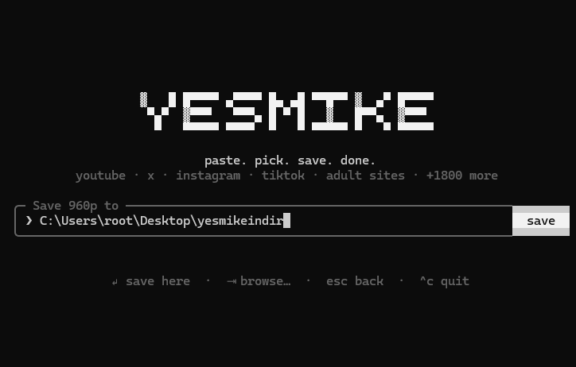

# yesmike

Terminal video downloader. Paste a link, pick a quality, pick a folder. Works with 1800+ sites (YouTube, X, Instagram, TikTok, Facebook, adult sites, …) via [yt-dlp](https://github.com/yt-dlp/yt-dlp).

## How it works

- **yt-dlp**: auto-downloaded on first run; does the real downloading.
- **Ink + htm**: React-style terminal UI, no build step.
- **Mouse**: terminal mouse reporting, clicks matched against the last drawn frame.
- **ffmpeg**: merges video + audio, converts to mp3.
- **Proxy / Tor**: passed to yt-dlp with `--proxy`, port checked every 5 s.
- **403**: auto-retry with browser impersonation, then yt-dlp update.

## Install

Needs Windows and [Node.js](https://nodejs.org) 20+.

```bash
git clone https://github.com/view004/yesmike.git
cd yesmike
npm install
```

## Run

Double-click `yesmike.bat`, or:

```bash
node yesmike.mjs [url]
```

Options: `--proxy <url>`, `--browser <name>` (use browser cookies), `-h`.

## Usage

### 1. Paste a link


`Enter` to go, `Tab` pastes from clipboard.

### 2. Proxy (optional)


`Ctrl+P`. Off by default. `●` = running, `○` = not running. For Tor, open Tor Browser first.

### 3. Pick a quality


`↑↓` or click, then `Enter`.

### 4. Choose a folder



Type a path or `Tab` to browse, then `Enter`.

### 5. Wait

Progress bar shows percent, speed and time left.

## Troubleshooting

- **proxy refused the connection**: proxy isn't running. Start Tor Browser or turn the proxy off.
- **HTTP 403**: retried automatically. Still failing? Use `--browser chrome` or a proxy.
- **Logo cut off**: make the window taller.

## Disclaimer

Download only content you have the right to download.

## License

MIT
