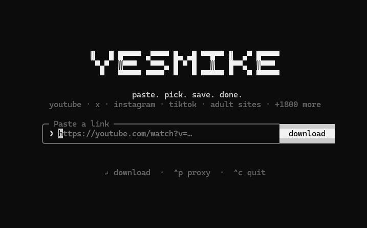
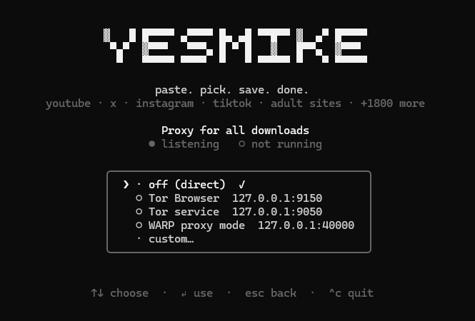
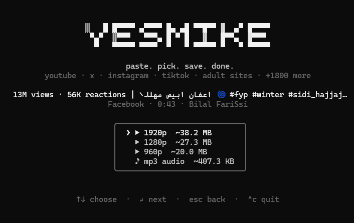

# yesmike

Terminal video downloader. Paste a link, pick a quality, pick a folder. Powered by [yt-dlp](https://github.com/yt-dlp/yt-dlp), so it works with 1800+ sites (YouTube, X, Instagram, TikTok, adult sites, …).

## Features

- Mouse and keyboard UI in the terminal
- Quality picker (video / mp3), folder picker (native dialog)
- Progress percentage, speed, ETA
- Proxy support: SOCKS5 / HTTP, presets for Tor Browser (9150), Tor service (9050), Cloudflare WARP (40000), live "proxy active" status
- Auto-retry on HTTP 403 (browser impersonation, yt-dlp self-update)
- yt-dlp is downloaded automatically on first run; ffmpeg is bundled

## Requirements

- Windows 10/11
- [Node.js](https://nodejs.org) 20+

## Screenshots

| Home | Proxy (`Ctrl+P`) | Quality picker |
| --- | --- | --- |
|  |  |  |

## Install

```bash
git clone https://github.com/view004/yesmike.git
cd yesmike
npm install
```

## Run

- Double-click `yesmike.bat` (opens a Windows Terminal window; falls back to plain cmd), or
- `node yesmike.mjs [url]`

### Options

| Flag | Meaning |
| --- | --- |
| `--proxy <url>` | e.g. `socks5h://127.0.0.1:9150` |
| `--browser <name>`, `-b` | use cookies from a browser (`chrome`, `firefox`, …) for login-only / blocked content |
| `-h` | help |

## Usage

1. Paste a link (or press `Tab` to use the one in your clipboard) and press `Enter`.
2. Choose a quality (`↑↓` / `j k` / number / click) and press `Enter`.
3. Choose the destination folder (`Tab` opens the folder dialog) and press `Enter`.
4. Wait for the progress bar to finish.

| Key | Action |
| --- | --- |
| `Ctrl+P` | proxy settings |
| `Tab` | paste from clipboard / browse folder |
| `Esc` | back |
| Click logo | back to home |

The proxy is off by default on every launch (set it with `Ctrl+P` or `--proxy`). Settings are stored in `~/.yesmike/config.json`, the yt-dlp binary in `~/.yesmike/bin`.

## Using Tor

Start Tor Browser (port 9150) or the Tor service (9050), press `Ctrl+P`, pick the matching preset. A green `● proxy active` line confirms the port is listening.

## Disclaimer

Download only content you have the right to download. You are responsible for how you use this tool.

## License

MIT
